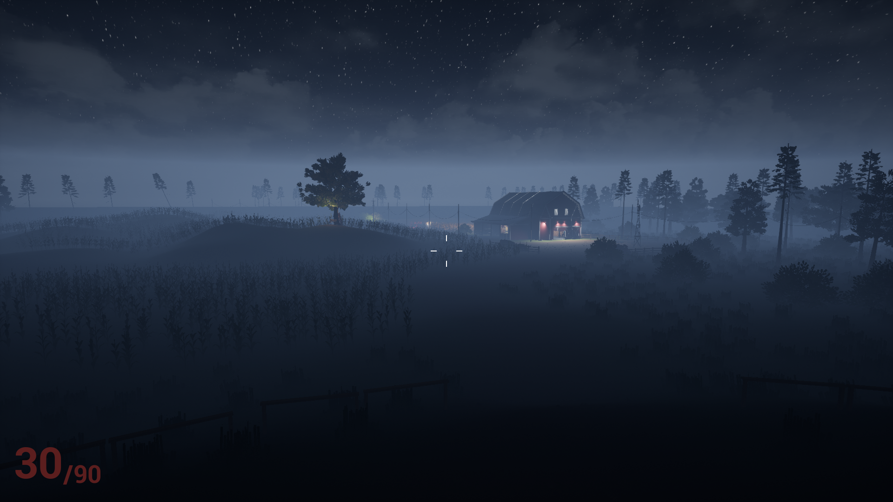
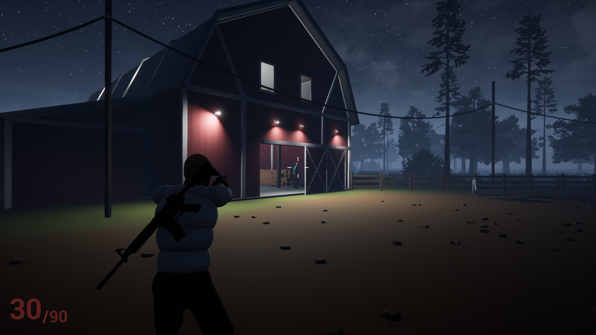
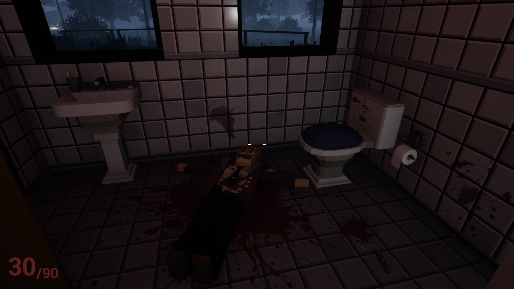
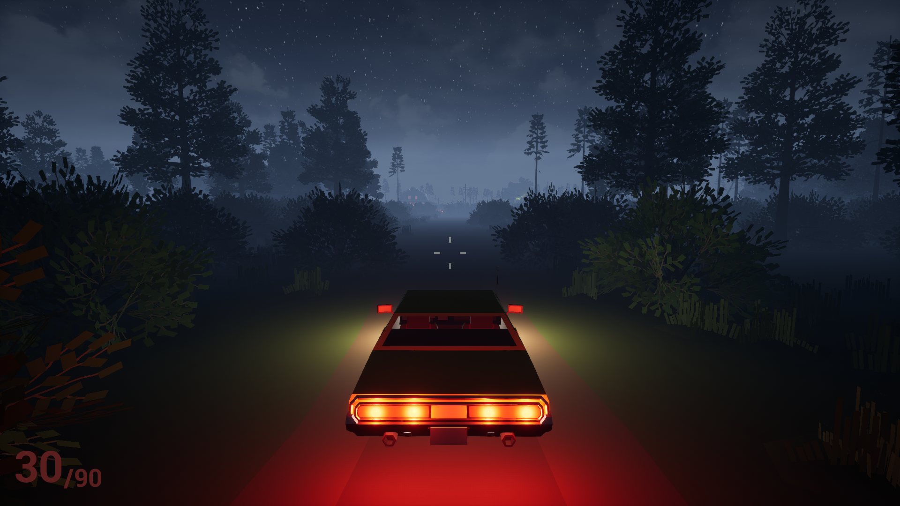
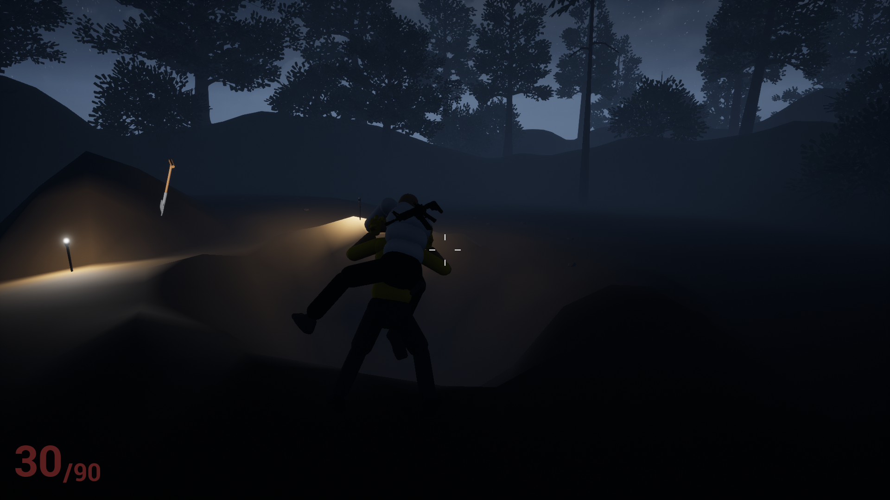

# Playable Level Prototype

**This is a playable level prototype for a crime mystery game**, showcasing its core gameplay mechanics, environmental design, and atmosphere. The prototype features a single level in which players investigate a mysterious incident at an isolated farm.

## About the Game

For decades, a series of unexplained child disappearances has haunted the outskirts of an otherwise quiet town. Every case shares one disturbing detail: the missing children are always twins. Despite the passage of time and numerous investigations, the truth remains buried.

You play as a detective determined to uncover the mystery behind these disappearances. During one of your investigations, you travel to an isolated farm to meet your police partner. But when you arrive, you find no sign of him. Instead, a wrecked police cruiser sits abandoned at the scene, surrounded by an unsettling silence.

What happened at the farm? Why did your partner never show up? And could this place hold the answers investigators have been searching for over decades?

## Prototype Features

- **Exploration:** Investigate an atmospheric rural environment on foot.
- **Vehicle Gameplay:** Drive vehicles and explore the surroundings.
- **Camera Switching:** Switch between different camera perspectives.
- **Object Interaction:** Collect keys and interact with elements of the environment.
- **Combat:** Use firearms as part of the gameplay experience.

The prototype demonstrates the foundations of the game's gameplay and atmosphere. It represents an early playable slice of a larger project, rather than a complete game.

## Download Playable Build

[**Download for Windows — Playable Prototype (v0.1.0)**](../../releases/latest)

## Screenshots

### The Farm

### Exploration and Investigation

### Driving

### Combat

## Controls

| Action | Key / Input |
|---|---|
| Enter / Exit Vehicle | `E` |
| Interact | `E` |
| Equip / Holster Rifle | `1` |
| Equip / Holster Pistol | `2` |
| Stealth Takedown | `F` |
| Switch Camera | `Hold V` |
| Crouch / Sneak | `Left Alt` |
| Aim | `Right Mouse Button` |

## Known Issues

- **Stealth Takedown:** The takedown mechanic currently requires precise positioning behind the enemy to trigger successfully.
- **Camera Tilt After Exiting a Vehicle:** When the player exits a vehicle parked on uneven terrain, the camera may become slightly tilted. This is a known issue in the current prototype.

## Development

- **Engine:** Unreal Engine 4
- **Platform:** Windows
- **Project Type:** Playable Level Prototype
